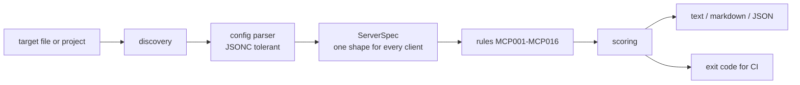

<div align="center">

# mcpseal

**Offline security audit for MCP server configuration.**
It reads the config your client actually loads, then prints explainable findings with the exact line to change.

[](#development)
[](https://www.python.org)
[](#why-zero-dependencies)
[](LICENSE)
[](#the-rule-set)

</div>

---

## The problem

A `.env` file is reviewed. A `Dockerfile` gets linted. A `package.json` gets
scanned by three different tools before lunch.

The MCP config does not. It is a tiny JSON file that nobody diffs, and it is
where the agent's actual privilege is granted:

```json
{
  "mcpServers": {
    "files": {
      "command": "npx",
      "args": ["-y", "@modelcontextprotocol/server-filesystem", "/"],
      "env": { "GITHUB_TOKEN": "ghp_..." },
      "autoApprove": true
    }
  }
}
```

Seven lines, and the model now has:

1. **your home directory** (`/`) for reading,
2. **a live GitHub token** in plaintext,
3. **write and execute tools that never ask permission**,
4. **an unpinned package** that installs whatever the registry serves today.

Nothing here is a CVE. Every line is valid, documented configuration. The
mistake is the combination, and it is invisible until an agent is talked into
using it - by a poisoned README, an issue body, a fetched web page.

`mcpseal` exists because the config is the last place a human can still see the
blast radius **before** the agent runs.

## What it does

```console
$ mcpseal ~/.cursor/mcp.json
==============================================================================
mcpseal  offline MCP configuration security audit
==============================================================================
Target       : /home/harry/.cursor/mcp.json
Config files : 1
               /home/harry/.cursor/mcp.json
Servers      : 3
Score        : 48/100  grade F
Findings     : 1 critical, 2 high, 1 medium, 0 low, 0 info

------------------------------------------------------------------------------
[CRITICAL] MCP001  Credential hardcoded in server environment
  Server   : files
  Evidence : env GITHUB_TOKEN holds a literal value (40 chars, matches a known credential prefix)
  Why      : The key sits in plaintext in a file that gets committed,
             synced and shared. Anyone who reads the config - or any tool
             the agent runs - has the credential, and rotating it means
             editing every copy.
  Fix      : Replace the literal with an environment reference such as
             ${GITHUB_TOKEN} and keep the real value in your shell profile
             or a secret manager. Rotate anything already committed.
  Ref      : MCP security best practices: no secrets in client config
------------------------------------------------------------------------------
```

Every finding carries four things: **evidence** (the exact argument, env key or
URL), **why** (the attack it enables), **fix** (the literal change), and a
**reference** (the CWE or principle behind it). No mystery scores, no "you have
4 issues" with no detail.

Point it at a project and it finds every config the project carries:

```console
$ mcpseal .                       # .mcp.json, .cursor/mcp.json, .vscode/mcp.json, ...
$ mcpseal ~/.cursor/mcp.json      # one file
$ mcpseal . --global              # project configs plus your per-user ones
$ mcpseal . --fail-on high        # CI gate
$ mcpseal . --format json         # machine readable
$ mcpseal --list-rules            # what it checks
```

## Install

```console
$ git clone https://github.com/mehulpatel23b-pixel/mcpseal
$ cd mcpseal
$ pip install -e .
$ mcpseal .
```

No install needed to try it - it has zero runtime dependencies, so a checkout
runs as-is:

```console
$ PYTHONPATH=src python -m mcpseal examples/vulnerable_mcp.json
```

## The rule set

| Rule | Severity | What it catches |
|---|---|---|
| `MCP001` | critical | Credential hardcoded in a server's `env` block |
| `MCP002` | high | Unpinned `npx` / `uvx` / `pkgx` package resolved at launch |
| `MCP003` | high | Server launched through `sh -c` / `cmd /c` / `powershell -Command` |
| `MCP004` | high | Filesystem server rooted at `/`, `~` or a whole user profile |
| `MCP005` | high | Write/delete access enabled on a broad root |
| `MCP006` | critical | Container escape surface: `--privileged`, docker socket, host net/pid |
| `MCP007` | high | Remote endpoint over plaintext HTTP |
| `MCP008` | medium | Remote endpoint with no authentication header |
| `MCP009` | critical | TLS verification disabled (`--insecure`, `NODE_TLS_REJECT_UNAUTHORIZED=0`) |
| `MCP010` | high | State-changing tools auto-approved without review |
| `MCP011` | medium | Container image without a tag or digest |
| `MCP012` | medium | Shell metacharacters inside a launch argument |
| `MCP013` | medium | Inline code shipped as `python -c` / `node -e` |
| `MCP014` | low | The same server registered twice under different names |
| `MCP015` | low | `cwd` pointing outside the audited project |
| `MCP016` | high | Credential embedded in the endpoint URL or query string |

Read-only auto-approval (`read_*`, `list_*`, `get_*`) is **not** flagged. The
rule is about side effects, not convenience.

## What counts as a client

Supported layouts, detected automatically from the file path:

| Client | Path | Server block |
|---|---|---|
| Claude Desktop | `claude_desktop_config.json` | `mcpServers` |
| Claude Code | `.mcp.json` | `mcpServers` |
| Cursor | `.cursor/mcp.json` | `mcpServers` (stdio or `url`) |
| VS Code | `.vscode/mcp.json` | `servers` + `type` |
| Windsurf | `.windsurf/mcp.json` | `mcpServers` |
| Kiro | `.kiro/settings/mcp.json` | `mcpServers` |

JSONC is fine: comments, trailing commas and hand-editing are expected, not
rejected.

## Scoring

The score is a health score: `100` minus a fixed weight per finding, floored at
zero.

| Severity | Weight | Meaning |
|---|---|---|
| critical | 40 | one of these should fail the build on its own |
| high | 18 | real exposure, fix before the server ships |
| medium | 7 | weakens the configuration, fix soon |
| low | 3 | hygiene |
| info | 0 | context only |

Grades: `A+` ≥ 95, `A` ≥ 90, `B` ≥ 80, `C` ≥ 70, `D` ≥ 60, else `F`.

## Exit codes

| Code | Meaning |
|---|---|
| `0` | audit completed, nothing at or above `--fail-on` (default `none`) |
| `1` | a finding at or above `--fail-on` exists |
| `2` | usage or configuration problem (missing file, invalid JSON, no servers) |

## In CI

```yaml
- name: Audit MCP configuration
  run: |
    pip install git+https://github.com/mehulpatel23b-pixel/mcpseal
    mcpseal . --fail-on high --format markdown --output mcpseal-report.md
```

The markdown report is table-first, so it reads well as a pull-request comment.

## What it deliberately does not do

* **No network.** No DNS, no HTTP, no package registry lookups. It reasons only
  about the file, so it is safe in an air-gapped review and fast enough to run
  on save.
* **No server launch.** It never spawns the MCP server it is auditing.
* **No runtime probing.** It cannot tell you whether a server *behaves* safely at
  runtime; it tells you whether the configuration *grants* more than it should.
  For probing a running server head to `mcp-probe`; for tool-schema ambiguity see
  `toolcheck`; for context cost see `mcptoll`.
* **No secret validation.** A literal that looks like a key is reported as a
  literal. It never tests whether the key is live, and never prints the value.

## Development

```console
$ pip install -e ".[dev]"
$ pytest            # 58 tests
$ mcpseal examples/vulnerable_mcp.json
$ mcpseal examples/hardened_mcp.json --fail-on none   # clean, grade A+
```

`examples/` carries a deliberately unsafe config and the same capabilities
configured safely, so the difference the tool is arguing about is one command
away.

Architecture:



## License

MIT - see [LICENSE](LICENSE).
